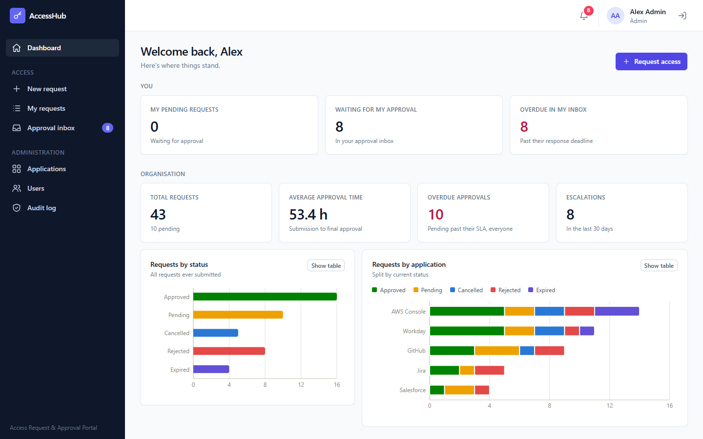
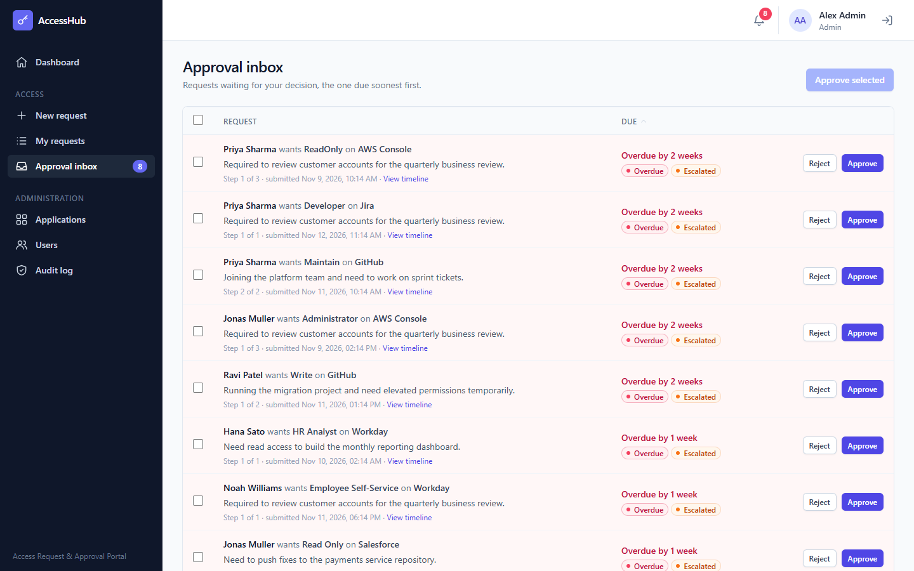
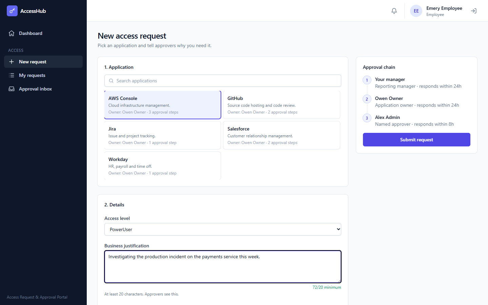
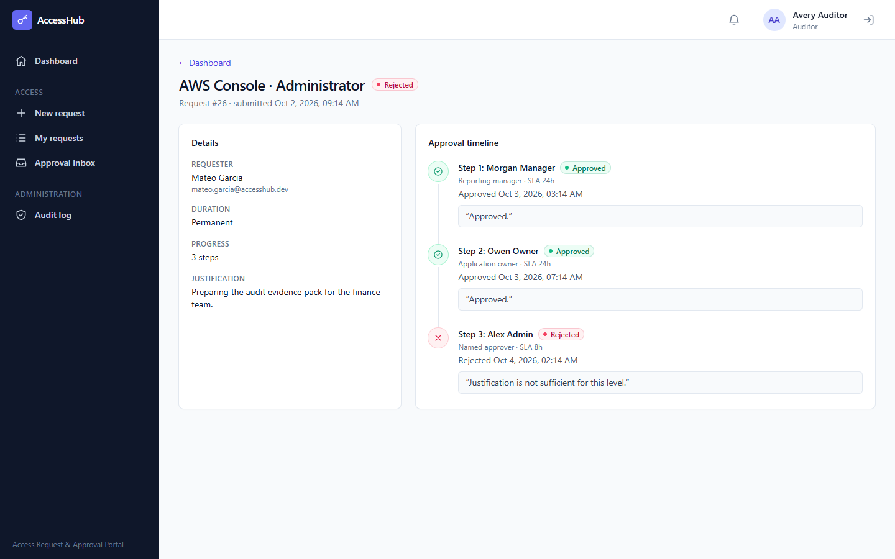
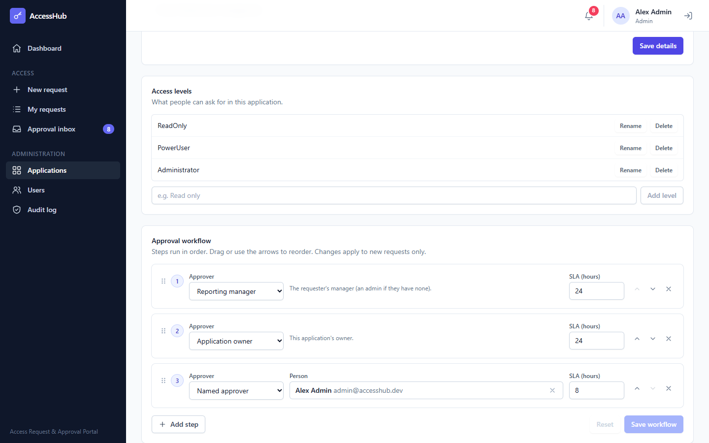
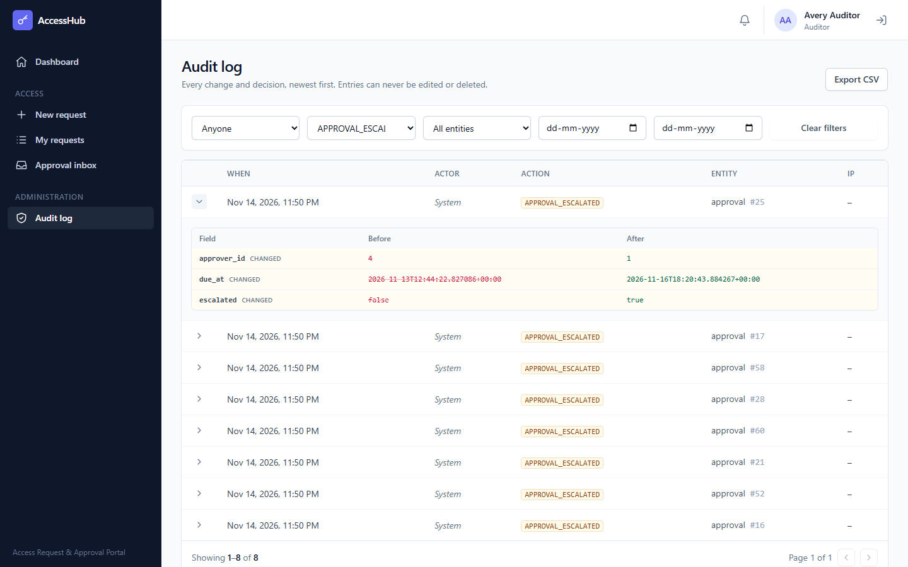
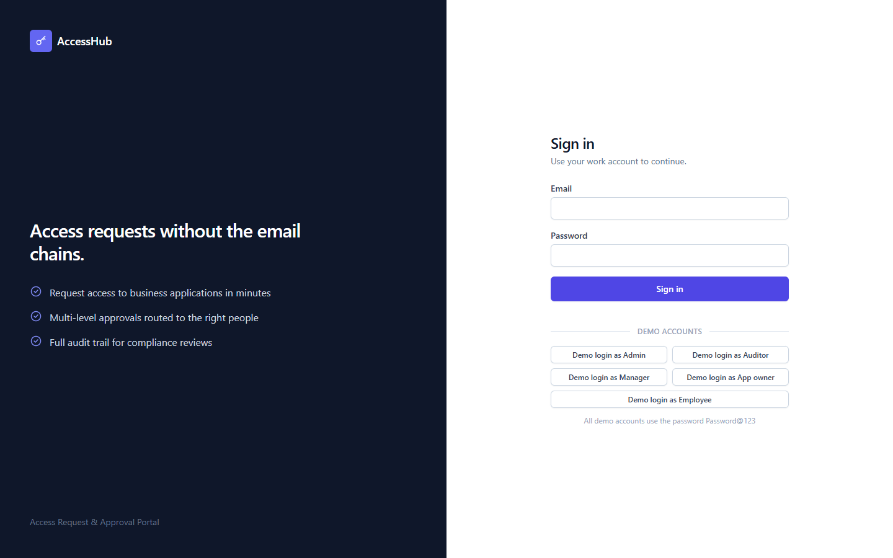
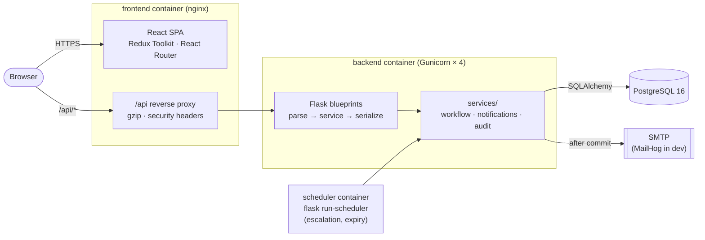
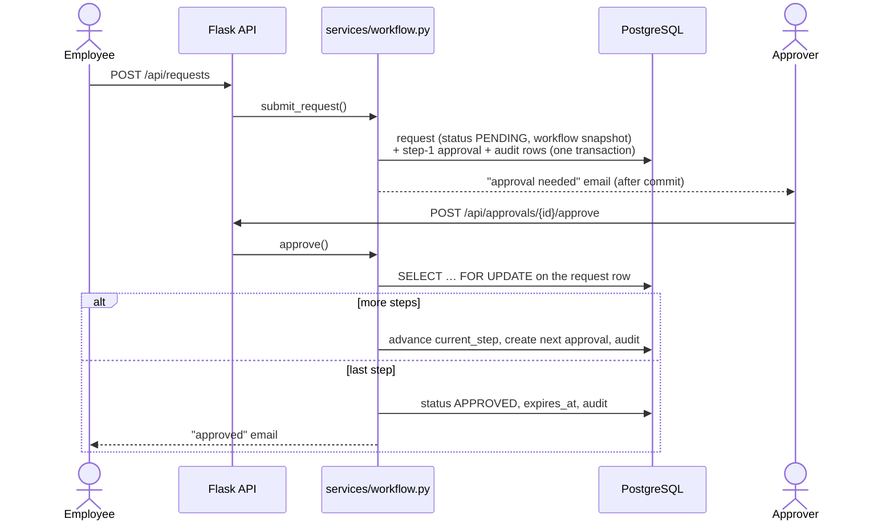
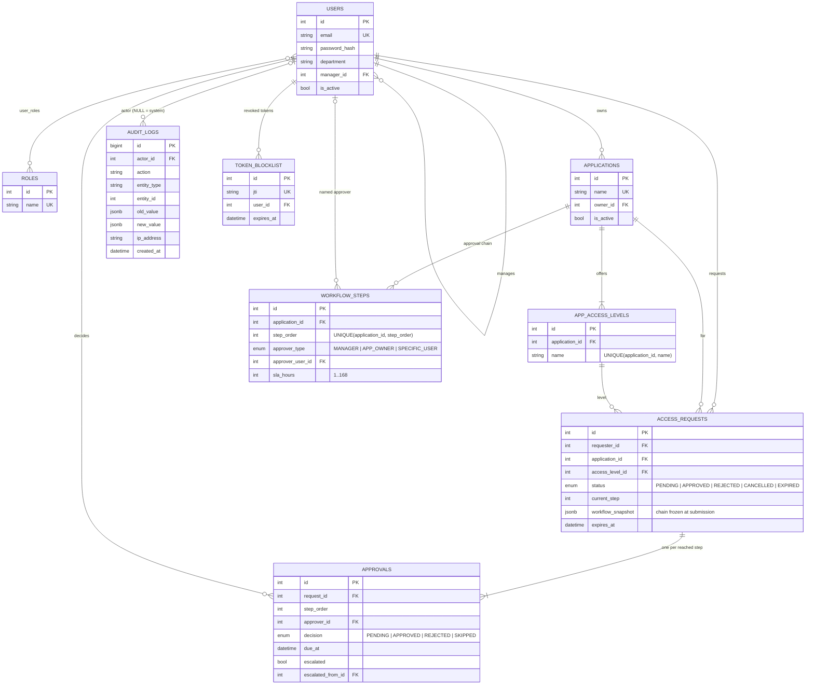

# AccessHub

**Access Request & Approval Portal.** Employees request access to business applications.
Managers, application owners and named approvers approve through configurable multi-level
workflows, and auditors review the full, tamper-proof history. It replaces "please give me
access" email threads with a tracked, time-limited and auditable process.

[CLAUDE.md](CLAUDE.md) is the project spec · [docs/SECURITY.md](docs/SECURITY.md) is the
security review · [docs/INTERVIEW.md](docs/INTERVIEW.md) explains the design decisions.

## Contents

- [Features](#features)
- [Screenshots](#screenshots)
- [Architecture](#architecture)
- [Data model](#data-model)
- [Tech stack](#tech-stack)
- [Run it locally](#run-it-locally)
- [Demo accounts](#demo-accounts)
- [Tests](#tests)
- [Production deployment](#production-deployment)
- [API reference](#api-reference)
- [Project layout](#project-layout)

## Features

**Requesting access**
- Search the application catalogue, pick an access level, justify it (at least 20 characters)
  and optionally make it time-limited. A preview shows who will approve, in order.
- Follow each request on a step-by-step timeline (approver, decision, comment, time,
  escalations). Cancel it while it is pending.

**Approving**
- Multi-step workflows per application. Each step is the requester's **manager**, the **app
  owner** or a **named person**, with its own SLA.
- Approval inbox, soonest-due first, with overdue highlighting, approve/reject (rejecting needs
  a comment) and bulk approve. Rows disappear immediately and come back if the server refuses.
- No self-approval: the engine falls back to the requester's manager, then an admin.
- Two approvers clicking at the same moment can't both win: the request row is locked
  (`SELECT … FOR UPDATE`) and the loser gets a clean "already decided".

**Automation**
- Emails (HTML and text) for approval needed, approved, rejected, escalated, expiring soon and
  expired, each with a deep link into the app.
- Overdue approvals escalate to the approver's manager (or an admin) every 15 minutes.
  Time-limited access expires automatically, with a reminder 7 days before.

**Administration and compliance**
- Applications admin with a drag-and-drop **workflow builder**. App owners manage only their
  own applications. Workflow edits never change requests already in flight.
- User management: create users (with a generated temporary password), departments, reporting
  lines (cycles rejected), roles and deactivation, with guards against locking out the last admin.
- **Your account** page: everyone can change their own password; doing so signs out every other
  session.
- **Append-only audit log** of every state change (enforced by a database trigger), with
  filters, a field-by-field diff view and streaming CSV export.
- Role-aware dashboard with organisation charts for admins and auditors.

**Security**: JWT access/refresh tokens with revocation, role checks plus object-level checks
on every endpoint, a login rate limit and account lockout, a password policy, and strict
security headers. See [docs/SECURITY.md](docs/SECURITY.md).

## Screenshots

| | |
|---|---|
| **Dashboard (admin)**: personal and organisation tiles, charts with table views<br> | **Approval inbox**: soonest due first, overdue highlighted<br> |
| **New request** with the approval-chain preview<br> | **Request timeline**: who decided what, and when<br> |
| **Workflow builder**: reorder steps, pick approvers, set SLAs<br> | **Audit log** with a field-by-field diff<br> |
| **Sign-in** with one-click demo accounts<br> | |

Regenerate them from a seeded dev stack with `cd frontend && npm run screenshots` (uses your
installed Chrome; see `frontend/scripts/screenshots.mjs`). The script also downloads the audit
CSV through the real **Export CSV** button and checks its contents.

## Architecture



**Request lifecycle**



## Data model



Key constraints: a partial unique index allows one PENDING request per user + app + level,
and another allows one PENDING approval per request. `audit_logs` rejects UPDATE and DELETE
through a trigger.

## Tech stack

| Layer | Technology |
|---|---|
| Frontend | React 18, Vite, React Router 6, Redux Toolkit (`createAsyncThunk`), Axios, Tailwind CSS, Recharts |
| Backend | Python 3.12, Flask 3 (app factory, blueprints), Flask-SQLAlchemy 3 / SQLAlchemy 2, Flask-Migrate (Alembic), Flask-JWT-Extended, Flask-Mail, Flask-CORS, Flask-Limiter, marshmallow, APScheduler |
| Database | PostgreSQL 16 |
| Testing | pytest, pytest-cov, factory-boy, freezegun (real Postgres); Vitest + React Testing Library |
| Delivery | Docker (multi-stage), docker compose, Gunicorn, nginx, GitHub Actions → GHCR |

## Run it locally

Requires Docker Desktop.

```bash
docker compose up --build                     # Postgres, API, Vite dev server, MailHog
docker compose exec backend flask db upgrade  # create the schema
docker compose exec backend flask seed        # demo data (safe to run repeatedly)
```

| Service | URL |
|---|---|
| App (Vite dev server) | http://localhost:5173 |
| API | http://localhost:5000/api/health |
| MailHog (outgoing email) | http://localhost:8025 |

Background jobs don't run on a schedule in development. Trigger them with
`docker compose exec backend flask escalate` and `docker compose exec backend flask expire`.

<details>
<summary>Run the backend or frontend outside Docker</summary>

```bash
# backend (needs Python 3.12 and a reachable Postgres)
cd backend
python -m venv .venv && source .venv/bin/activate   # Windows: .venv\Scripts\activate
pip install -r requirements-dev.txt
cp .env.example .env
flask db upgrade && flask seed && flask run --debug

# frontend
cd frontend && npm install && npm run dev            # proxies /api to localhost:5000
```
</details>

## Demo accounts

All use the password **`Password@123`**. The sign-in page also has one-click buttons for them.

| Email | Roles | Try |
|---|---|---|
| `employee@accesshub.dev` | employee | request access, follow the timeline, cancel |
| `manager@accesshub.dev` | manager, employee | approve your reports' requests in the inbox |
| `owner@accesshub.dev` | app_owner, employee | approve owner steps; edit your apps' workflows |
| `admin@accesshub.dev` | admin, employee | applications, users, reassignment, dashboard charts |
| `auditor@accesshub.dev` | auditor, employee | audit log, diff view, CSV export, dashboard charts |

The seed also creates 10 more employees (e.g. `priya.sharma@accesshub.dev`), 5 applications
(Jira, Salesforce, GitHub, AWS Console, Workday) with 1–3 approval steps each, and 40
historical requests in every state.

## Tests

```bash
docker compose exec backend pytest --cov=app        # ~330 tests, real Postgres, fails under 85% coverage
docker compose exec backend ruff check . && docker compose exec backend ruff format --check .
cd frontend && npm test && npm run lint             # Vitest + RTL, ESLint with zero warnings
```

Notable backend suites:

| Suite | What it proves |
|---|---|
| `tests/unit/test_workflow.py` | engine rules end to end, rollback on failure, and a real two-transaction race on the row lock |
| `tests/integration/test_permissions.py` | every role × every protected endpoint is allowed or gets 403 |
| `tests/integration/test_audit_invariant.py` | every POST/PUT/DELETE route (read from Flask's URL map) and every background job writes an audit row |
| `tests/integration/test_query_counts.py` | list endpoints run the same number of SQL queries for 2 rows as for 8 (no N+1) |
| `tests/integration/test_security.py` | rate limit, account lockout, password policy, production secret checks |
| `tests/unit/test_migrations.py` | the Alembic migrations exactly match the models |

The test database (`accesshub_test`) is created by `docker/postgres/init` the first time the
Postgres volume starts, and its schema is built by running the real migrations.

## Production deployment

```
            :80
  browser ───────► frontend (nginx)
                     ├─ /            SPA (static files, index.html fallback, gzip, security headers)
                     └─ /api/*  ───► backend (Gunicorn, 4 workers, non-root) ──► postgres
                                      │       scheduler (same image, RUN_SCHEDULER=1) ──┘
                                      └──► redis (rate-limit counters)
  with docker-compose.tls.yml:  browser ─HTTPS:443─► caddy (Let's Encrypt, HSTS) ──► nginx ──► …
```

```bash
cp .env.production.example .env                          # real secrets, SMTP, FRONTEND_URL
docker compose -f docker-compose.prod.yml up -d          # pull images from GHCR
docker compose -f docker-compose.prod.yml up -d --build  # or build locally
```

- **backend**: `backend/Dockerfile` target `prod`. Its entrypoint runs `flask db upgrade`, then
  Gunicorn. `RUN_SCHEDULER=0`, so it can be scaled (`--scale backend=3`).
- **scheduler**: the same image running `flask run-scheduler`. It is the only process that runs
  the jobs.
- **frontend**: `frontend/Dockerfile` (Node build, then `nginx:1.27-alpine`) with
  `frontend/nginx.conf`. Hashed assets are cached for a year; `index.html` is always revalidated.
- `PROXY_FIX_HOPS=1` makes audit logs record the real client IP behind nginx. Production refuses
  to start with missing, short or placeholder secrets.
- **redis** holds the login rate-limit counters, so all Gunicorn workers share one limit.

**HTTPS.** Point your domain's DNS at the server, set `SITE_ADDRESS` in `.env`, and add the TLS
override:

```bash
docker compose -f docker-compose.prod.yml -f docker-compose.tls.yml up -d
```

[Caddy](deploy/Caddyfile) then becomes the public entry point on ports 80/443. It obtains and
renews a Let's Encrypt certificate automatically, redirects HTTP to HTTPS and sends HSTS. nginx
stays behind it, unpublished. The backend trusts two proxies (`PROXY_FIX_HOPS=2`), so audit logs
still record the real client IP. Keep the `caddy_data` volume: it holds the certificates. To try
it locally, set `SITE_ADDRESS=localhost` and Caddy uses its own local certificate authority.

### CI/CD (`.github/workflows/ci.yml`)

| Job | When | What |
|---|---|---|
| backend | every push / PR | Postgres 16 service, ruff lint + format check, pytest with coverage (fails under 85%) |
| frontend | every push / PR | `npm ci`, ESLint, Vitest, production build |
| images | push to `main` | both `prod` images pushed to `ghcr.io/<owner>/accesshub-{backend,frontend}`, tagged with the commit SHA and `latest` |
| deploy | push to `main`, **only if the deploy secrets exist** | SSH to the server, `docker compose pull && up -d` with the new SHA |

Deploy secrets: `DEPLOY_HOST`, `DEPLOY_USER`, `DEPLOY_SSH_KEY` (optional `DEPLOY_PORT`,
`DEPLOY_PATH`, default `/opt/accesshub`). The server needs Docker, `docker-compose.prod.yml`
and `.env` in `DEPLOY_PATH`, and must be able to pull from GHCR.

## API reference

All endpoints are under `/api` and use JSON. Errors look like
`{"error": {"code", "message", "details"}}`. Lists take `?page=&per_page=` and return
`{"items", "page", "per_page", "total"}`.

| Endpoint | Who | Notes |
|---|---|---|
| `POST /auth/login`, `/auth/refresh`, `/auth/logout`, `GET /auth/me` | public / token | 15-min access and 7-day refresh tokens; logout revokes both; login is rate-limited with an account lockout |
| `POST /auth/change-password` | signed in | `{current_password, new_password}`; returns fresh tokens and revokes every older one |
| `POST /requests` | employee | `{application_id, access_level_id, justification, duration_days?}` |
| `GET /requests` | any | own requests (auditors/admins: everyone's). Filters `status`, `application_id`, `requester_id`, `from`, `to`, `mine` |
| `GET /requests/<id>` | requester, its approvers, auditor, admin | approval timeline + step list; 404 for anyone else |
| `POST /requests/<id>/cancel` | requester | only while PENDING |
| `GET /approvals/inbox` | any | my PENDING approvals, soonest due first, `is_overdue` |
| `POST /approvals/<id>/approve`, `/reject` | assigned approver | reject needs `{comment}` |
| `POST /approvals/<id>/reassign` | admin | `{approver_id, reason}` |
| `GET/POST /applications`, `GET/PUT/DELETE /applications/<id>` | read: any · write: admin or the app's owner | DELETE is a soft delete |
| `…/<id>/access-levels[/<level_id>]` | admin or owner | levels already used by requests can't be deleted |
| `GET/PUT /applications/<id>/workflow` | read: any · write: admin or owner | PUT replaces the whole ordered list atomically |
| `GET/POST /users`, `GET/PUT /users/<id>`, `PUT /users/<id>/roles` | admin | search and filters; password policy; cycle and lockout guards |
| `GET /users/lookup?q=` | admin, app_owner | brief active users for pickers |
| `GET /audit`, `GET /audit/export.csv` | auditor, admin | filters `actor` (id or `system`), `action`, `entity_type`, `entity_id`, `from`, `to` |
| `GET /reports/summary` | auditor, admin | counts by status and app, average approval hours, escalations, overdue |
| `GET /health` | public | `{"status", "db"}` |

## Project layout

```
backend/
  app/
    blueprints/      HTTP routes (parse → call service → serialize)
    services/        business logic: workflow.py, escalation.py, notifications.py, audit.py, …
    models/          SQLAlchemy 2.x models, one per module
    schemas/         marshmallow input/output schemas
    templates/email/ HTML + text email templates
  migrations/        Alembic migrations (incl. the audit-log append-only trigger)
  tests/             unit/ and integration/ suites (real Postgres)
deploy/              Caddyfile (HTTPS edge for docker-compose.tls.yml)
frontend/
  scripts/           screenshots.mjs (README screenshots + CSV export check)
  src/api/           axios client (token refresh queue) and per-resource modules
  src/features/      auth, requests, approvals, applications, users, audit, dashboard
  src/components/    shared UI (DataTable, ProtectedRoute, Layout, modals, toasts, …)
  nginx.conf         production web server config
docker/              Postgres init script (creates the test database)
docs/                SECURITY.md, INTERVIEW.md
.github/workflows/   CI/CD
```
